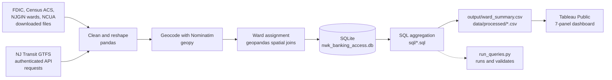

# Newark Banking Access & Transit Equity

**Question:** Which of Newark's five wards have the least access to mainstream banking, and how does that line up with income, rent burden, bus service, and rent pressure?

A Python + SQL + geospatial pipeline that combines FDIC bank branches, NCUA credit unions, hand-compiled alternative financial services (check cashing, payday lending, money transfer, pawn), NJ Transit bus service, and Census data, tags everything to Newark's wards, aggregates it with SQL in SQLite, and publishes the result as a Tableau Public dashboard.

## Dashboard

**[Open the interactive dashboard on Tableau Public](https://public.tableau.com/app/profile/justin.argueta/viz/nwk_banking_dash/Dashboard1)**


Each panel is fed by one SQL file in [`sql/`](sql/), which in turn depends on the Python script(s) that built the underlying table. `python run_queries.py` re-runs every query and checks it against the export Tableau reads.

| Dashboard panel | SQL file | Tableau source export | Upstream Python |
|---|---|---|---|
| Income vs Rent Burden | [`01_income_vs_rent_burden.sql`](sql/01_income_vs_rent_burden.sql) | `output/ward_summary.csv` | `clean_census_data.py`, `build_ward_database.py` |
| Gentrification Pressure Gap | [`02_gentrification_pressure_gap.sql`](sql/02_gentrification_pressure_gap.sql) | `output/ward_summary.csv` | `compute_gentrification_metrics.py` |
| Transit Headway & Stop Count | [`03_transit_headway_stop_count.sql`](sql/03_transit_headway_stop_count.sql) | `output/ward_summary.csv` | `download_gtfs_bus.py`, `spatial_join_wards.py`, `compute_transit_frequency.py` |
| Bank vs Alt-Finance Count | [`04_bank_vs_alt_finance_count.sql`](sql/04_bank_vs_alt_finance_count.sql) | `output/ward_summary.csv` | `geocode_alt_finance.py`, `spatial_join_wards.py`, `build_ward_database.py` |
| Ward Overview Map (Total Financial Access Count) | [`05_ward_overview_total_financial_access.sql`](sql/05_ward_overview_total_financial_access.sql) | `output/ward_summary.csv` | `add_credit_unions.py`, `spatial_join_wards.py` |
| FDIC Bank Branches Map | [`06_fdic_bank_branches_map.sql`](sql/06_fdic_bank_branches_map.sql) | `data/processed/fdic_branches_by_ward.csv` | `spatial_join_wards.py`, `verify_branch_counts.py` |
| Alt-Finance Map (by `check_cashing`, `money_transfer`, `pawn_shop`, `payday_loan`) | [`07_alt_finance_map.sql`](sql/07_alt_finance_map.sql) | `data/processed/alt_finance_by_ward.csv` | `geocode_alt_finance.py`, `spatial_join_wards.py` |

The Tableau workbook is not stored in this repo, so the panel-to-export mapping is based on the exports' column names and the dashboard's published design. [`08_validation_checks.sql`](sql/08_validation_checks.sql) is not a panel; it holds the data-quality checks behind the findings below.

## Data sources

| Data | Source | In repo | Used for |
|---|---|---|---|
| Bank branches | FDIC branch data, Essex County extract (187 branches; 51 in Newark) | `data/raw/fdic_branches_EC.csv` | Bank counts, FDIC map |
| Bus stops, routes, schedules | NJ Transit bus GTFS, downloaded through an authenticated API (`download_gtfs_bus.py`, credentials in `.env`) | `data/raw/gtfs-bus/` | 958 Newark stops; weekday headway |
| Income, rent burden, rent | Census ACS 5-Year: B19013 (median household income), B25070 (rent burden), B25064 (median gross rent); 2024 and 2019 vintages for the growth comparison | `data/raw/census_*_essex.csv` | Ward demographics, gentrification gap |
| Tract boundaries | Census TIGER/Line 2024, Essex County (`download_tract_boundaries.py`) | `data/raw/essex_tract_boundaries.geojson` | Tract geometry |
| Ward boundaries | NJGIN, 5 Newark wards | `data/raw/newark_wards.geojson` | Ward assignment |
| Alternative financial services | 31 manually compiled businesses (check cashing, payday/installment lending, money transfer, pawn) | `data/raw/alt_financial_services_newark.csv` | Alt-finance counts and map |
| Credit unions | NCUA branch and field-of-membership files, 2026 Q2 | `data/raw/ncua_*_2026q2.txt` | Public-access credit unions |

## Pipeline



Scripts in `scripts/`, in run order:

| # | Script | What it does |
|---|---|---|
| 1 | `download_gtfs_bus.py` | Authenticates against the NJ Transit GTFS API with `requests` and extracts the feed |
| 2 | `download_tract_boundaries.py` | Downloads TIGER/Line tracts and filters to Essex County |
| 3 | `geocode_alt_finance.py` | Geocodes the 31 alt-finance addresses with Nominatim, retries failures with unit suffixes stripped, flags results outside a Newark bounding box |
| 4 | `clean_census_data.py` | Reshapes wide ACS tables to one row per tract, computes `pct_rent_burdened`, flags top-coded and suppressed income, joins tract geometry |
| 5 | `spatial_join_wards.py` | Filters FDIC to Newark and joins FDIC branches, alt-finance points, and bus stops to ward polygons (point-in-polygon) |
| 6 | `build_ward_database.py` | Assigns tracts to wards by centroid, builds the SQLite database, runs the per-ward summary query |
| 7 | `compute_gentrification_metrics.py` | 2019 to 2024 rent and income growth per tract; writes `tract_growth` |
| 8 | `compute_transit_frequency.py` | Weekday 6 AM to 8 PM headway per stop from GTFS `stop_times`, averaged to ward; exports bus route lines |
| 9 | `add_credit_unions.py` | Joins NCUA branches to field-of-membership, geocodes, spatial-joins to wards, separates public (community-chartered) from restricted credit unions |
| - | `verify_branch_counts.py` | Diagnostic: re-joins all FDIC branches by coordinates alone and compares with the city-filter result |

## Python stack

- **pandas**: reshaping wide Census tables, GTFS headway calculation, CSV exports
- **geopandas**: point-in-polygon ward assignment (`sjoin`), tract centroids in a projected CRS
- **geopy**: Nominatim geocoding with rate limiting
- **sqlite3**: building the database and running the SQL files (`run_queries.py` uses only the standard library)
- **requests / python-dotenv**: authenticated GTFS download with credentials kept out of git

Wards come from a spatial join on coordinates rather than ZIP codes, because ZIP codes do not nest within Newark's wards.

## SQL

The relational layer is SQLite (`data/nwk_banking_access.db`): `fdic_branches` (51 rows), `alt_finance` (31), `transit_stops` (958), `tract_demographics` (88), and `tract_growth` (88), all tagged with a ward. The files in `sql/` aggregate them to the grain each panel needs and use:

- **CTEs** to build per-table ward aggregates and then combine them (`01`, `02`, `04`, `05`)
- **Joins across ward-tagged tables** with a `LEFT JOIN` ward spine, so a ward with zero points still shows up (`04`, `05`)
- **Window functions**: `RANK() OVER` per metric (`01` to `05`), `SUM() OVER ()` for share of citywide total (`05`), `AVG() OVER ()` for deviation from the ward average (`02`), `COUNT() OVER (PARTITION BY ...)` and `ROW_NUMBER()` on the point-level exports (`06`, `07`)

Two inputs never entered the database because the original scripts wrote them to CSV only: stop-level headway (computed in pandas from raw GTFS) and the credit union tables. `run_queries.py` stages them into an in-memory copy of the database so the SQL for panels 03 and 05 still runs. The committed `.db` is opened read-only and never modified.

```text
$ python run_queries.py 04
=== 04_bank_vs_alt_finance_count.sql ===
  ward     bank_branch_count  alt_finance_count  alt_finance_to_bank_ratio  fewest_banks_rank  most_alt_finance_rank
  Central  12                 12                 1.000                      4                  1
  East     26                 11                 0.423                      5                  2
  North    6                  4                  0.667                      3                  3
  South    2                  2                  1.000                      1                  4
  West     5                  2                  0.400                      2                  4
  VALIDATED vs output/ward_summary.csv: 5 rows x 3 columns match
```

## Key findings

- **South Ward has 2 FDIC-insured branches**, against 26 in East and 51 citywide. South is still second in bus stop count (230), so its gap is in banking rather than stop coverage.
- **East Ward has the worst weekday bus headway**, 20.2 minutes on average, even with 26 branches and 179 stops. Central is the best at 12.6.
- **Only 2 of 13 Newark-area credit union branches are open to the general public.** Both belong to North Jersey (community-chartered), in Central and West wards. The other 11 serve occupational, associational, or multiple-common-bond memberships, so East, North, and South have no public credit union branch.
- **Alternative financial services are concentrated in Central**: 12 of the 31 businesses, one per FDIC branch there. South also has a 1.0 ratio, from only 2 and 2.
- **Rent growth versus income growth, 2019 to 2024:** rent growth minus income growth is negative in every ward (the tract-average income growth outpaced rent growth), least negative in East at -8.6 points versus about -36 in South (-35.8) and North (-35.7). West is -15.5 and Central -29.5.
- **Income and rent burden:** East has the highest average tract median income ($61,102) and South the lowest ($50,825). Rent burden runs from 55.2% (Central) to 61.6% (West).

## Validation methodology

- **Ward assignment of bank branches, three ways.** South's count of 2 was checked with (1) the city-name filter then spatial join, (2) a coordinates-only spatial join of all 187 Essex County branches with no city filter (`verify_branch_counts.py`), and (3) a manual Google Maps check. Methods 1 and 2 agree for all five wards (12 / 26 / 6 / 2 / 5); the Google Maps check was manual and is not scripted.
- **Geocode quality.** Every geocode is checked against a Newark bounding box; all 31 alt-finance rows have `geocode_status = ok`.
- **SQL reconciles to what Tableau reads.** `run_queries.py` compares each panel query with its source export, row by row and column by column (numeric tolerance 1e-9), and exits non-zero on any difference.
- **Headline figures are asserted in SQL.** `08_validation_checks.sql` returns PASS/FAIL for row counts, null wards, the South and East branch counts, East headway, the East growth gap, and the credit union counts.
- **Credit union membership types.** NCUA ships no value-level decode for `TOM_CODE`, so `add_credit_unions.py` maps codes from NCUA's published scheme and checks it against two credit unions with known charters.
- **Known limitations.** Ward values are unweighted means of tract values, not household-weighted. 3 of 88 tracts have no income estimate and 1 has no rent-burden estimate; 5 lack either growth metric (83 have both), which `compute_gentrification_metrics.py` attributes to likely tract boundary changes between the 2019 and 2024 vintages. The alt-finance list is 31 hand-compiled businesses, not a complete census. Headway is the mean gap between consecutive buses of any route at a stop.

## Reproduction

Tested with Python 3.12 on Windows.

**See the SQL run against the committed data (no install needed):**

```bash
python run_queries.py          # all queries, printed and validated
python run_queries.py 02 05    # selected files
```

**Rebuild from raw data (heavier; hits the network):**

```bash
pip install -r requirements.txt     # pandas arrives as a geopandas dependency
```

Put NJ Transit developer credentials in `.env` as `NJT_USERNAME` and `NJT_PASSWORD`, then run the scripts from the repo root in the order above. Notes:

- `fdic_branches_EC.csv`, the Census CSVs, `newark_wards.geojson`, and the NCUA files are downloaded files placed in `data/raw/`; no script fetches them.
- Geocoding calls Nominatim at one request per second, and a re-run can return slightly different coordinates.
- `build_ward_database.py` deletes and recreates the database; `compute_gentrification_metrics.py`, `compute_transit_frequency.py`, and `add_credit_unions.py` update `output/ward_summary.csv` in place, so run them after it.
- `geocode_alt_finance.py` uses repo-relative paths; run it from the repo root.
